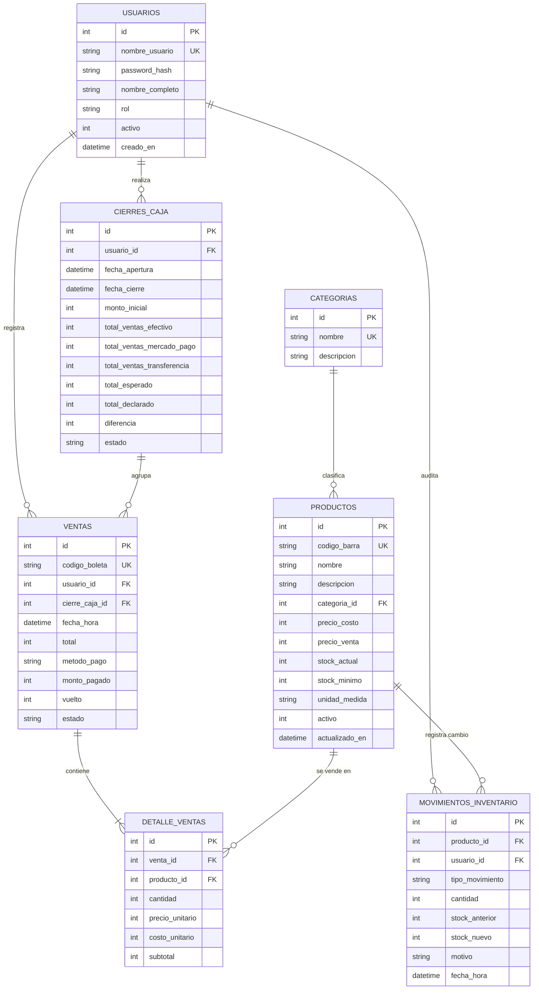

# Modelo de Base de Datos - Sistema Minimarket Patty

Este documento contiene la especificación formal del modelo de datos para el **Sistema de Control de Inventario y Ventas para Minimarket Patty**, desarrollado en el marco de la asignatura **Taller de Sistemas de Información (UTEM 2026)**.

---

## 1. Diagrama Entidad - Relación (Conceptual)

---

## 2. Modelo Físico - Relacional Normalizado (Tercera Forma Normal - 3FN)

El diseño cumple estrictamente con las reglas de normalización:
* **1FN:** Todos los atributos son atómicos (sin listas de productos o múltiples valores en una sola celda).
* **2FN:** Todos los atributos no clave dependen funcionalmente de la totalidad de la clave primaria.
* **3FN:** No existen dependencias transitivas entre atributos no clave. Por ejemplo:
  * El cálculo del costo y precio en `detalle_ventas` se almacena históricamente (`precio_unitario` y `costo_unitario`) para garantizar inmutabilidad histórica frente a cambios futuros en la tabla `productos`.
  * La categoría se desacopla en su propia entidad `categorias`.

---

## 3. Diccionario de Datos

### 3.1. Tabla: `usuarios`
| Campo | Tipo | Nulo | Clave | Descripción |
| :--- | :--- | :--- | :--- | :--- |
| `id` | INTEGER | NO | PK (AI) | Identificador correlativo del usuario |
| `nombre_usuario` | VARCHAR(50) | NO | UNIQUE | Nombre de cuenta de inicio de sesión |
| `password_hash` | VARCHAR(255) | NO | | Hash criptográfico de la contraseña (SHA-256) |
| `nombre_completo` | VARCHAR(100) | NO | | Nombre y apellido para tickets y auditoría |
| `rol` | VARCHAR(20) | NO | | Rol: `'ADMINISTRADOR'` o `'CAJERO'` |
| `activo` | INTEGER | NO | | 1 = Activo, 0 = Desactivado |
| `creado_en` | TIMESTAMP | NO | | Fecha y hora de creación de la cuenta |

### 3.2. Tabla: `categorias`
| Campo | Tipo | Nulo | Clave | Descripción |
| :--- | :--- | :--- | :--- | :--- |
| `id` | INTEGER | NO | PK (AI) | Identificador de la categoría |
| `nombre` | VARCHAR(60) | NO | UNIQUE | Nombre de la categoría (ej: Abarrotes, Aseo) |
| `descripcion` | TEXT | SÍ | | Detalle de los tipos de artículos comprendidos |

### 3.3. Tabla: `productos`
| Campo | Tipo | Nulo | Clave | Descripción |
| :--- | :--- | :--- | :--- | :--- |
| `id` | INTEGER | NO | PK (AI) | Identificador interno del producto |
| `codigo_barra` | VARCHAR(50) | NO | UNIQUE, INDEX | Código EAN-13/UPC para lector de barras |
| `nombre` | VARCHAR(120) | NO | | Nombre comercial del producto |
| `descripcion` | TEXT | SÍ | | Formato, marca o especificación |
| `categoria_id` | INTEGER | NO | FK | Referencia a `categorias(id)` |
| `precio_costo` | INTEGER | NO | | Costo de adquisición unitario en CLP |
| `precio_venta` | INTEGER | NO | | Precio de venta final a público en CLP |
| `stock_actual` | INTEGER | NO | | Cantidad disponible en local/bodega |
| `stock_minimo` | INTEGER | NO | | Umbral de alerta para reposición |
| `unidad_medida` | VARCHAR(20) | NO | | Unidad de medida (`'UNIDAD'`, `'KG'`, etc.) |
| `activo` | INTEGER | NO | | 1 = En venta, 0 = Descontinuado |
| `actualizado_en` | TIMESTAMP | NO | | Última fecha de modificación |

### 3.4. Tabla: `cierres_caja`
| Campo | Tipo | Nulo | Clave | Descripción |
| :--- | :--- | :--- | :--- | :--- |
| `id` | INTEGER | NO | PK (AI) | Identificador del turno/sesión de caja |
| `usuario_id` | INTEGER | NO | FK | Cajero responsable del turno |
| `fecha_apertura` | TIMESTAMP | NO | | Inicio del turno |
| `fecha_cierre` | TIMESTAMP | SÍ | | Cierre del turno |
| `monto_inicial` | INTEGER | NO | | Fondo de caja inicial en efectivo |
| `total_ventas_efectivo` | INTEGER | NO | | Suma de ventas en efectivo |
| `total_ventas_mercado_pago` | INTEGER | NO | | Suma de ventas con terminal Mercado Pago |
| `total_ventas_transferencia`| INTEGER | NO | | Suma de transferencias bancarias |
| `total_esperado` | INTEGER | NO | | Total calculado por el sistema |
| `total_declarado` | INTEGER | NO | | Efectivo real contado al cierre |
| `diferencia` | INTEGER | NO | | Descuadre (`declarado - esperado`) |
| `observaciones` | TEXT | SÍ | | Notas del cajero o administradora |
| `estado` | VARCHAR(20) | NO | | `'ABIERTA'` o `'CERRADA'` |

### 3.5. Tabla: `ventas`
| Campo | Tipo | Nulo | Clave | Descripción |
| :--- | :--- | :--- | :--- | :--- |
| `id` | INTEGER | NO | PK (AI) | Identificador interno de la venta |
| `codigo_boleta` | VARCHAR(30) | NO | UNIQUE | Folio o número de ticket interno |
| `usuario_id` | INTEGER | NO | FK | Usuario que procesó la venta |
| `cierre_caja_id` | INTEGER | SÍ | FK | Turno de caja en el que se efectuó |
| `fecha_hora` | TIMESTAMP | NO | INDEX | Fecha y hora exacta de la transacción |
| `total` | INTEGER | NO | | Monto total a pagar en CLP |
| `metodo_pago` | VARCHAR(30) | NO | | `'EFECTIVO'`, `'MERCADO_PAGO'`, `'TRANSFERENCIA'` |
| `monto_pagado` | INTEGER | NO | | Dinero entregado por el cliente |
| `vuelto` | INTEGER | NO | | Cambio entregado al cliente |
| `estado` | VARCHAR(20) | NO | | `'COMPLETADA'` o `'ANULADA'` |

### 3.6. Tabla: `detalle_ventas`
| Campo | Tipo | Nulo | Clave | Descripción |
| :--- | :--- | :--- | :--- | :--- |
| `id` | INTEGER | NO | PK (AI) | Identificador de línea |
| `venta_id` | INTEGER | NO | FK | Referencia a `ventas(id)` |
| `producto_id` | INTEGER | NO | FK, INDEX | Referencia a `productos(id)` |
| `cantidad` | INTEGER | NO | | Unidades vendidas |
| `precio_unitario` | INTEGER | NO | | Precio de venta congelado al momento |
| `costo_unitario` | INTEGER | NO | | Costo unitario congelado al momento |
| `subtotal` | INTEGER | NO | | `cantidad * precio_unitario` |

### 3.7. Tabla: `movimientos_inventario`
| Campo | Tipo | Nulo | Clave | Descripción |
| :--- | :--- | :--- | :--- | :--- |
| `id` | INTEGER | NO | PK (AI) | Identificador de movimiento |
| `producto_id` | INTEGER | NO | FK, INDEX | Producto afectado |
| `usuario_id` | INTEGER | NO | FK | Usuario que realizó o causó el cambio |
| `tipo_movimiento` | VARCHAR(30) | NO | | `'ENTRADA_COMPRA'`, `'VENTA'`, `'AJUSTE_POSITIVO'`, `'AJUSTE_NEGATIVO'`, `'MERMA_VENCIMIENTO'` |
| `cantidad` | INTEGER | NO | | Cantidad modificada |
| `stock_anterior` | INTEGER | NO | | Existencia previa en bodega |
| `stock_nuevo` | INTEGER | NO | | Existencia posterior en bodega |
| `motivo` | TEXT | SÍ | | Justificación de la corrección o factura proveedor |
| `fecha_hora` | TIMESTAMP | NO | | Momento del movimiento |
